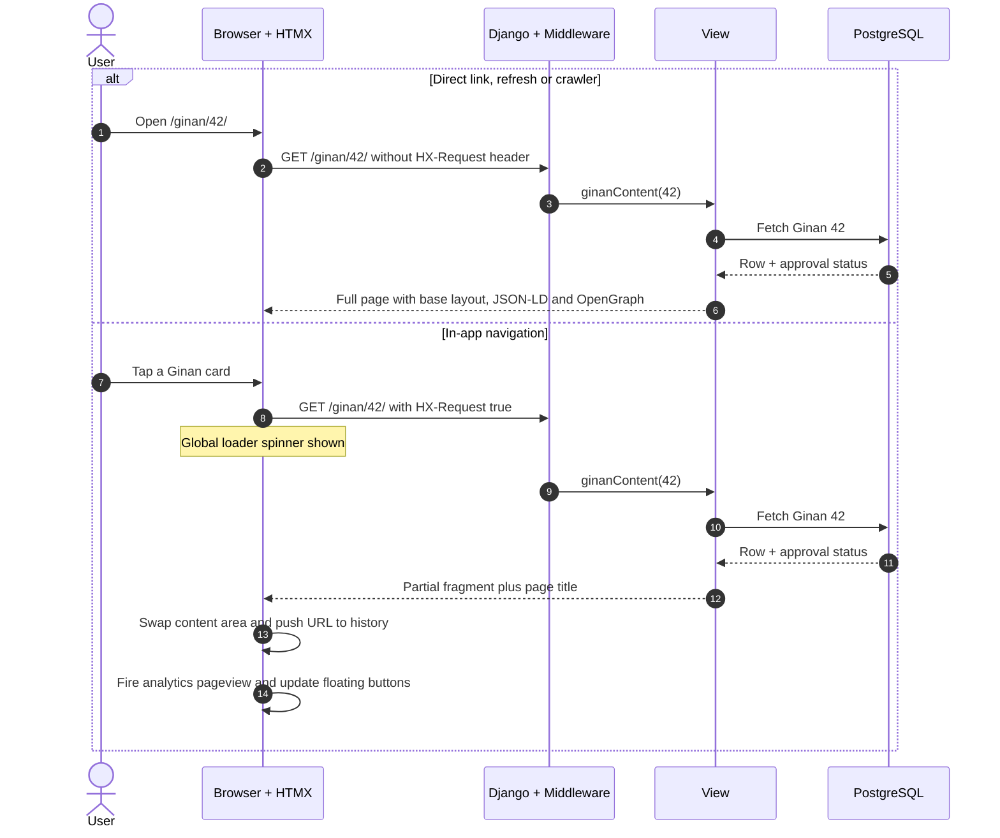
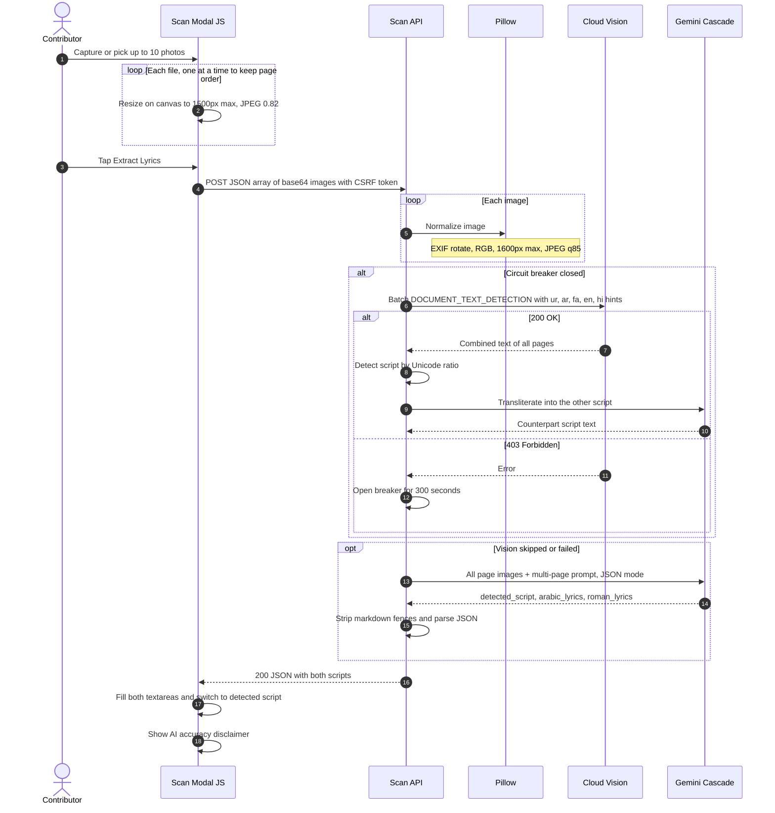
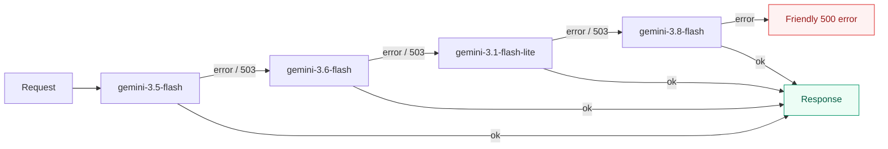

# Architecture Deep Dive

How <a href="https://theqasida.com">theqasida.com</a> works, based on the production codebase

  <a href="#1-design-principles">Principles</a> •
  <a href="#2-request-lifecycles">Lifecycles</a> •
  <a href="#3-client-state-management">State</a> •
  <a href="#4-storage--caching">Storage</a> •
  <a href="#5-resilience--scalability">Resilience</a> •
  <a href="#6-security">Security</a>

---

## 1. Design Principles

| Principle | What it means in Qasida |
| :-- | :-- |
| **Hypermedia over JSON** | Pages are rendered on the server by Django and swapped into place with HTMX. There's no SPA bundle, and routing and validation live only on the server. |
| **Every URL works on its own** | Each route returns either an HTMX fragment or a full page, so deep links, refreshes and crawlers always get complete HTML. |
| **AI degrades gracefully** | Scanning still works when Cloud Vision is disabled or a Gemini model is overloaded, because each step has a fallback. |
| **Images are never stored** | Scanned photos exist only in memory for the length of the request. |

---

## 2. Request Lifecycles

### 2.1 Navigation: HTMX partial vs. full page

**Search** follows the same pattern. The input fires `GET /search/` after 500ms of inactivity, and the server returns only the list partial, which replaces `#home-list`. Each search word is turned into an OR filter across title, poet name and language name, and the word filters are combined with AND. The query is limited to approved works and deduplicated.

---

### 2.2 AI lyrics scan: up to 10 pages

#### Gemini model failover

Each model gets **one attempt** (`HttpRetryOptions(attempts=1)`) and `thinking_budget=0`. Failures move on quickly instead of retrying a model that's struggling, and OCR and transliteration don't spend time on reasoning tokens.

---

## 3. Client State Management

The outer shell (`base.html`: nav, floating buttons, loader) stays in place across navigations, and only `#content-area` is replaced. The two are kept in sync through HTMX events:

| Concern | Mechanism |
| :-- | :-- |
| **Browser history** | Every link uses `hx-push-url="true"`, so back and forward work as normal. |
| **Analytics** | `htmx:pushedIntoHistory` sends a virtual pageview with the new path. |
| **Tab title** | Partials include a `<title>` only when `request.htmx` is true, and HTMX applies it after the swap. |
| **Floating buttons** | `updateFabVisibility()` checks the current path on load and again on `pushedIntoHistory`, `afterSettle` and `popstate`. The upload and scroll-to-top buttons appear only on `/`. |
| **Scroll-to-top** | A passive scroll listener shows the button once the page is scrolled past 400px. |
| **Scan queue** | An in-memory `queuedScanImages[]` array holds the pages. Files are read in a chained callback (not `Promise.all`) so they stay in the order chosen. Each thumbnail has a **Page N** badge and can be removed on its own. |
| **Script toggle** | Switching between Roman (LTR) and Arabic/Urdu (`dir="rtl"`, larger type) happens entirely in the browser, both in the reader and in the upload editor. |

---

## 4. Storage & Caching

| Layer | Technology | Details |
| :-- | :-- | :-- |
| **Database** | PostgreSQL (Neon) / SQLite | Configured with `dj_database_url`. `conn_max_age=0` suits Neon's serverless connection pooling. |
| **Static files** | WhiteNoise | `CompressedStaticFilesStorage` serves pre-compressed CSS, images and `htmx.min.js` straight from the app, with no CDN needed. |
| **CSS** | django-tailwind | Tailwind compiles utility classes from `theme/static_src` into a single built stylesheet. |
| **Image processing** | `io.BytesIO` + Pillow | Images are processed in memory only. Nothing is written to disk or object storage. |
| **Failure cache** | Module-level timestamp | Each worker remembers a Cloud Vision `403` for 300 seconds and skips Vision until it expires. |
| **Video** | YouTube ID only | Only the 11-character ID is stored. Playback goes through `youtube-nocookie.com` with lazy loading. |

---

## 5. Resilience & Scalability

- **Bounded request size.** The client compresses each phone photo to roughly 150–300 KB. The server rejects requests with more than 10 images, and Django's upload memory limits are set to 50 MB.
- **Fails fast.** The circuit breaker and single-attempt model cascade keep slow upstream services from making scans slower.
- **Stateless web tier.** Gunicorn workers hold no session-critical state (sessions are stored in the database), so the service can scale horizontally on Render. The breaker flag lives in each worker, so it only saves time and has no effect on correctness.
- **Clear error messages.** Errors are returned as structured JSON (`400` for an empty or unreadable image, `500` when no AI provider is available). The UI shows them in a modal instead of failing silently.

---

## 6. Security

| Area | Control |
| :-- | :-- |
| **Authentication** | `@login_required` on upload, profile and the scan API. The scan API also requires POST (`@require_POST`). |
| **CSRF** | The CSRF middleware is enabled, and the JSON `fetch()` calls send an `X-CSRFToken` header. |
| **Moderation** | New uploads are saved with `is_approved=False`. Opening an unapproved work returns **404** unless you're the author or a superuser. Admins approve uploads in bulk with a custom admin action. |
| **Transport** | In production (`DEBUG=False`): SSL redirect, the proxy SSL header, **HSTS for 1 year** with subdomains and preload, and secure session and CSRF cookies. |
| **Injection** | User values written into JSON-LD are escaped with `escapejs`, and Django templates escape HTML automatically. Clickjacking protection comes from `XFrameOptionsMiddleware`. |
| **Secrets** | All keys and connection strings come from environment variables. Credential files and `.env` are excluded from git. |
| **Crawl surface** | `robots.txt` disallows `/admin/` and `/api/`. |

---

<a href="./README.md">← Back to README</a> · <a href="https://theqasida.com">theqasida.com</a>

