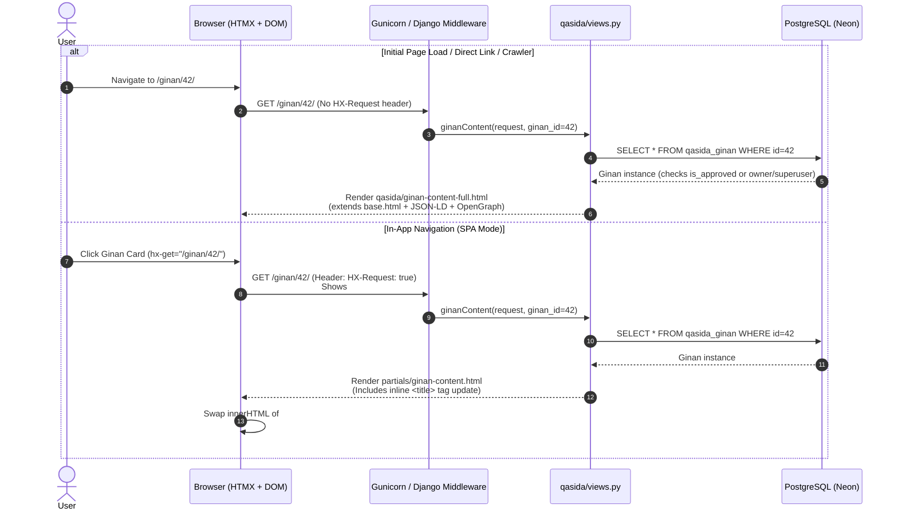
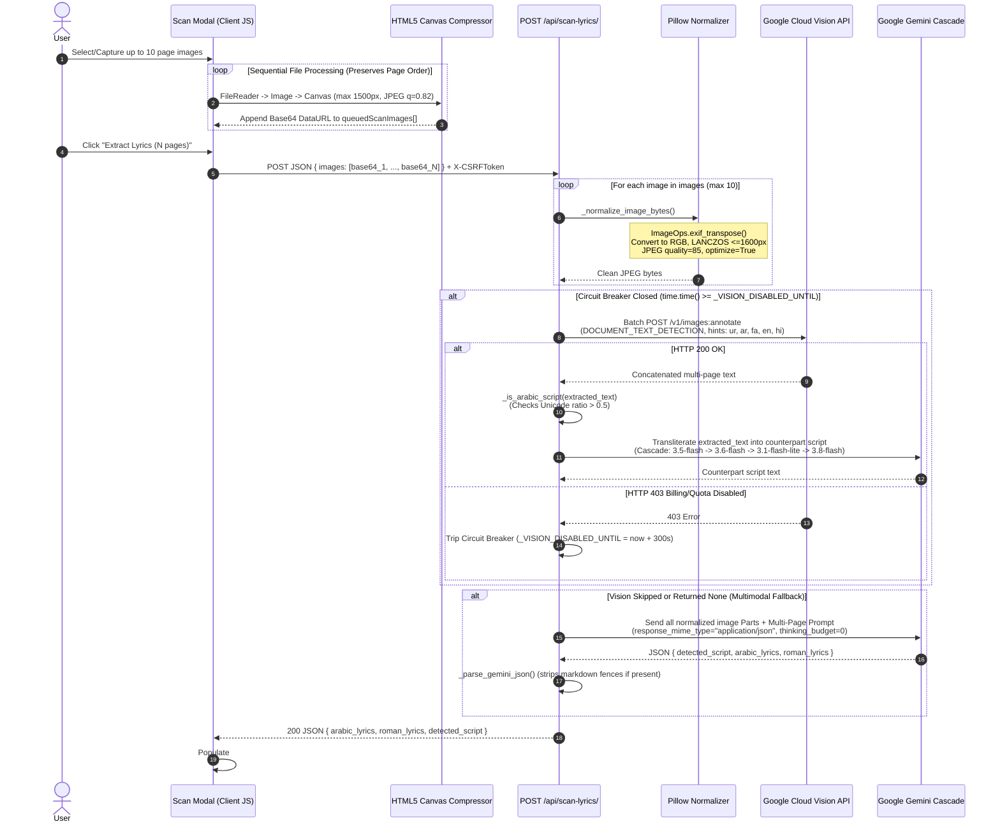

# System Architecture & Technical Deep Dive

This document provides an in-depth engineering breakdown of **Qasida**, derived directly from its production Django + HTMX + AI codebase.

---

## 1. High-Level Architectural Philosophy

Qasida is designed around **Hypermedia-Driven Applications (HDA)** principles coupled with a **Hybrid Multimodal AI Pipeline**:

1. **Zero Client-Side Framework Bloat:** Instead of shipping a heavy SPA bundle (React/Next.js) and duplicating routing, state serialization, and validation logic across frontend and backend, Qasida uses **Django 4.2** templates paired with **HTMX (`1.26.0`)** and **Tailwind CSS (`3.4.19`)**.
2. **Progressive Enhancement & SEO Parity:** Every route supports both HTMX fragment swaps (`request.htmx == True`) and full-document SSR (`request.htmx == False`). Search engines, social media unfurlers, and direct deep-link visitors receive complete HTML documents with Schema.org JSON-LD and OpenGraph metadata, while interactive users experience instant SPA-like transitions without full page reloads.
3. **Fault-Tolerant Multimodal AI Digitization:** Converting photos of multi-page devotional books into dual-script (Roman + RTL Arabic/Urdu) text is handled via an asynchronous JSON endpoint (`POST /api/scan-lyrics/`) that combines client-side canvas compression, server-side Pillow normalization, Google Cloud Vision OCR, a latency-protecting circuit breaker, and a multi-model Google Gemini failover cascade.

---

## 2. Request Lifecycles

### 2.1 Dual-Mode Navigation & Search Lifecycle (HTMX vs. SSR)

Every view controller in `qasida/views.py` branches on `request.htmx` (populated by `django_htmx.middleware.HtmxMiddleware` inspecting the `HX-Request` header):



#### Live Search & Category Filtering
- **Debounced Trigger:** The search input (`partials/home-partial.html`) uses `hx-get="/search/"`, `hx-trigger="keyup delay:500ms changed"`, and `hx-target="#home-list"`.
- **Relational Token Reduction:** In `views.py:search`, the query string is tokenized by whitespace. Each word generates a compound `Q` filter across three tables (`Ginan.title`, `Poet.name`, `Language.name`):
  ```python
  word_query = (
      Q(title__icontains=word) |
      Q(poet__name__icontains=word) |
      Q(language__name__icontains=word)
  )
  ```
  All word queries are intersected via `reduce(operator.and_, word_queries)` and filtered by `is_approved=True` with `.distinct().order_by('title')`, returning only `partials/home-list.html` to replace the `#home-list` DOM node.

---

### 2.2 Multi-Page AI Lyrics Extraction & Transliteration Lifecycle

When a contributor clicks **Scan Lyrics** on the upload page (`partials/upload-partial.html`), the system executes a multi-stage pipeline designed to handle up to **10 sequential pages** of physical books in a single request:



---

## 3. State Management & Client-Side Coordination

Because Qasida uses HTMX for navigation, the outer shell (`qasida/base.html`) persists across page transitions while `#content-area` is swapped. State synchronization between the persistent shell and dynamic partials is managed through event-driven JavaScript hooks:

1. **History & Analytics Synchronization:**
   - Every navigation link includes `hx-push-url="true"`.
   - `base.html` listens to `htmx:pushedIntoHistory` on `document.body` to report virtual pageviews (`event.detail.path`) to Google Analytics (`gtag`).
   - Partial templates (`partials/ginan-content.html`, `partials/poet-profile-partial.html`) conditionally emit `<title>...</title>` when `request.htmx` is truthy so HTMX updates the browser tab title during partial swaps.
2. **Context-Aware Floating Action Buttons (`#fab-container`):**
   - The mobile **Upload FAB** and **Scroll-to-Top** button reside in `base.html` but should only appear on the home route (`/`).
   - `updateFabVisibility()` inspects `window.location.pathname` on initial load and re-evaluates on `htmx:pushedIntoHistory`, `htmx:afterSettle`, and `window.popstate` (browser back/forward buttons).
   - A passive scroll listener (`{ passive: true }`) reveals `#scroll-top-btn` only when `window.scrollY > 400` on the home route.
3. **Client-Side Scan Queue State (`queuedScanImages`):**
   - In `partials/upload-partial.html`, multi-page image uploads are read sequentially via recursive `processNext()` callbacks rather than parallel `Promise.all` reads, guaranteeing that Page 1 through Page $N$ remain in the exact order selected by the user.
   - Users can preview page thumbnails with `Page N` badges, remove individual pages (`splice(index, 1)`), or clear the entire queue before triggering extraction.
4. **Dual-Script Reader & Editor State:**
   - Both the reader (`partials/ginan-content.html`) and the upload editor (`partials/upload-partial.html`) provide instant client-side toggling between **Roman (LTR, centered)** and **Arabic/Urdu (`dir="rtl"`, `leading-loose`, larger font scale)** without round-tripping to the server.

---

## 4. Storage, Caching & Static Asset Strategy

| Layer | Technology | Implementation Details |
| :--- | :--- | :--- |
| **Primary Database** | PostgreSQL (Neon) / SQLite | Configured via `dj_database_url.config()` in `ginan/settings.py`. Uses `conn_max_age=0` to remain compatible with serverless PostgreSQL connection pooling on Neon. |
| **Static Files** | WhiteNoise (`6.9.0`) | Uses `whitenoise.storage.CompressedStaticFilesStorage` (`STORAGES['staticfiles']`) to serve pre-compressed (Gzip/Brotli) CSS, images, and `htmx.min.js` directly from the WSGI worker without an external CDN requirement. |
| **In-Memory Image Processing** | Python `io.BytesIO` + Pillow | Camera uploads for AI scanning are processed **100% in memory** (`io.BytesIO` buffers). Raw photos are never written to disk or object storage, eliminating storage bloat and privacy risks from user camera uploads. |
| **API Circuit-Breaker Cache** | Module-level `_VISION_DISABLED_UNTIL` | Caches HTTP `403` failure states from Google Cloud Vision for `300` seconds in worker memory, preventing repeated 3-second network timeouts when falling back to Gemini multimodal OCR. |
| **CSS Build Pipeline** | `django-tailwind` (`3.6.0`) | Compiles utility classes from `theme/static_src` into `theme/static/css/dist/styles.css`, purged for production during `collectstatic`. |

---

## 5. Scalability, Resilience & Security Considerations

### 5.1 AI Latency & Fault Tolerance
- **Model Cascade Failover:** External LLM endpoints occasionally experience transient `503` overloads or rate limits. `call_gemini()` iterates through four distinct Gemini models (`gemini-3.5-flash`, `gemini-3.6-flash`, `gemini-3.1-flash-lite`, `gemini-3.8-flash`) with `HttpRetryOptions(attempts=1)` per model so a stalled model fails fast and immediately routes to the next available model.
- **Zero-Thinking Budget for OCR:** Gemini requests explicitly set `thinking_config=types.ThinkingConfig(thinking_budget=0)` to disable reasoning token overhead, minimizing time-to-first-token on deterministic OCR and transliteration tasks.
- **Payload Boundedness:**
  - Client-side canvas compression shrinks multi-megabyte smartphone photos to ~150–300 KB JPEGs before transmission.
  - Server-side `DATA_UPLOAD_MAX_MEMORY_SIZE` and `FILE_UPLOAD_MAX_MEMORY_SIZE` are capped at `50 MB` (`settings.py`), and `scan_lyrics` enforces a strict maximum of `10` images per request.

### 5.2 Application & Transport Security
- **Authentication & Endpoint Protection:**
  - `upload`, `profile`, and `scan_lyrics` are protected by `@login_required`.
  - `scan_lyrics` additionally enforces `@require_POST` and validates the Django `X-CSRFToken` header on all JSON `fetch()` requests.
- **Content Moderation & Authorization Gate:**
  - All user-submitted Ginans are created with `is_approved=False`.
  - `views.py:ginanContent` enforces strict authorization before rendering unapproved records:
    ```python
    if not ginan.is_approved:
        if not request.user.is_authenticated or (request.user != ginan.submitted_by and not request.user.is_superuser):
            raise Http404("This ginan is pending approval or does not exist.")
    ```
- **Production Hardening (`DEBUG = False`):**
  When deployed with `DEBUG=False` (configured via `render.yaml`), `ginan/settings.py` automatically activates:
  - `SECURE_SSL_REDIRECT = True` with `SECURE_PROXY_SSL_HEADER = ('HTTP_X_FORWARDED_PROTO', 'https')`
  - **HTTP Strict Transport Security (HSTS):** `SECURE_HSTS_SECONDS = 31536000` (1 year), `SECURE_HSTS_INCLUDE_SUBDOMAINS = True`, and `SECURE_HSTS_PRELOAD = True`
  - **Secure Cookies:** `SESSION_COOKIE_SECURE = True` and `CSRF_COOKIE_SECURE = True`
  - **Clickjacking & XSS Defenses:** `XFrameOptionsMiddleware`, `CsrfViewMiddleware`, and ` escapejs` filters on all user-supplied strings interpolated into `<script type="application/ld+json">` blocks.
- **Credential Isolation:**
  - Service account keys (`credentials/`), `.env` files, and `SECRET_KEY` values are isolated via environment variables (`GEMINI_API_KEY`, `GOOGLE_CREDENTIALS_JSON`, `GOOGLE_APPLICATION_CREDENTIALS`, `DATABASE_URL`).
