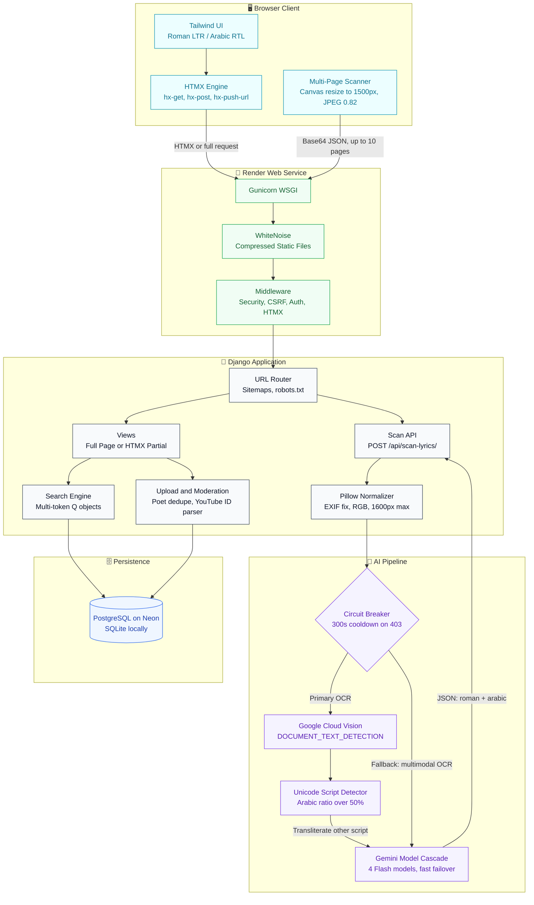
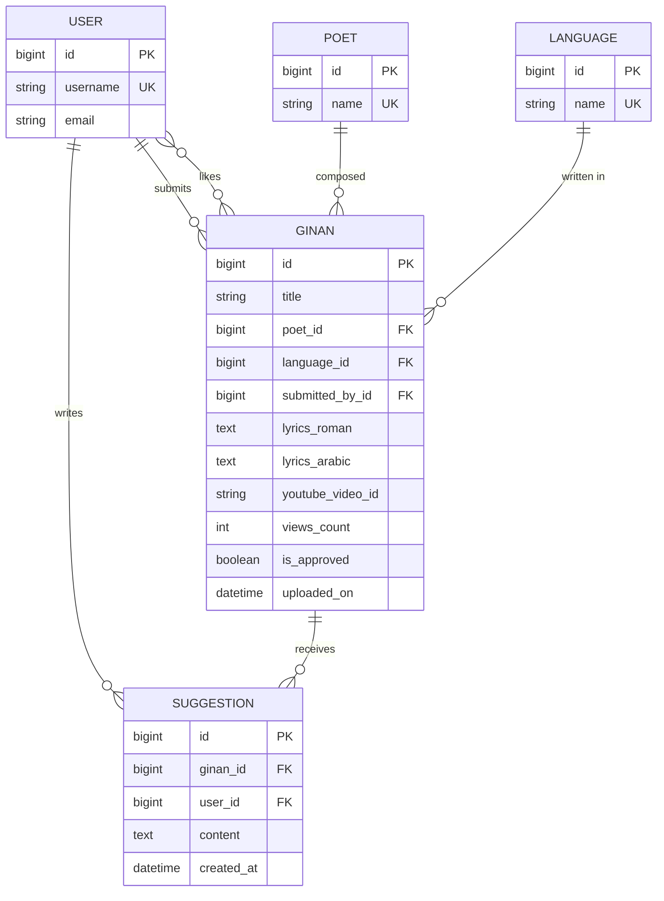

<div align="center">

<a href="https://theqasida.com">
  
</a>

### A community archive of Ginans & Qasidas, with AI that turns photos of old books into lyrics in both Roman and Arabic script

<p>
  <a href="https://theqasida.com"></a>
  <a href="./ARCHITECTURE.md"></a>
  
</p>

<p>
  
  
  
  
  
  
  
  
</p>

<p>
  <a href="#-overview">Overview</a> •
  <a href="#-demo">Demo</a> •
  <a href="#-the-problem">Problem</a> •
  <a href="#-architecture">Architecture</a> •
  <a href="#-engineering-highlights">Highlights</a> •
  <a href="#-data-model">Data Model</a> •
  <a href="#-source-code-access">Access</a>
</p>

</div>

---

## 📖 Overview

**[Qasida](https://theqasida.com)** is a full-stack web archive for traditional devotional poetry (Ginans and Qasidas). Readers can search the collection, switch between **Roman transliteration** and **right-to-left Arabic/Urdu script** with one tap, and listen to recordings. Contributors can **photograph up to 10 pages of a physical booklet**. An AI pipeline then extracts the verses and produces both scripts automatically.

<table>
  <tr>
    <td width="33%" valign="top">
      <h4>🔎 Instant search</h4>
      Search updates as you type and matches across titles, poets and languages, all without a page reload.
    </td>
    <td width="33%" valign="top">
      <h4>🔤 Two scripts per work</h4>
      Read each work in Roman or RTL Arabic/Urdu script, with an embedded YouTube recording.
    </td>
    <td width="33%" valign="top">
      <h4>📸 AI page scanner</h4>
      Turns photos of up to 10 pages into lyrics in both scripts using Cloud Vision and Gemini.
    </td>
  </tr>
  <tr>
    <td width="33%" valign="top">
      <h4>🛡️ Moderated contributions</h4>
      New uploads stay hidden until an admin approves them. Admins can approve in bulk.
    </td>
    <td width="33%" valign="top">
      <h4>⚡ Fast navigation without a JS framework</h4>
      HTMX swaps in page fragments, but every URL still renders as a full page on its own.
    </td>
    <td width="33%" valign="top">
      <h4>🌐 Built for search engines</h4>
      Pages include JSON-LD, OpenGraph tags, dynamic sitemaps and a <code>robots.txt</code>.
    </td>
  </tr>
</table>

---

## 🎬 Demo

<div align="center">

**🌐 Live at [theqasida.com](https://theqasida.com)**


</div>

<br />

<table>
  <tr>
    <td align="center" width="50%">
      <br />
      <sub><b>Home</b>: search as you type, plus language filter buttons</sub>
    </td>
    <td align="center" width="50%">
      <br />
      <sub><b>Reader</b>: Roman / Arabic toggle with an embedded YouTube player</sub>
    </td>
  </tr>
  <tr>
    <td align="center" width="50%">
      <br />
      <sub><b>AI scanner</b>: queue up to 10 pages for extraction</sub>
    </td>
    <td align="center" width="50%">
      <br />
      <sub><b>Profiles</b>: a poet's works and a contributor's uploads</sub>
    </td>
  </tr>
</table>

---

## 🧩 The Problem

Lyrics for Ginans and Qasidas are scattered across old printed books, worn community booklets and handwritten family notebooks. Digitizing them raises three engineering problems:

| Challenge | Why it's hard | How Qasida solves it |
| :-- | :-- | :-- |
| **Two scripts** | Readers need Roman *and* RTL Arabic/Urdu text, but a source page usually has only one. | AI transliteration generates the missing script, and both are stored on the same record. |
| **Slow manual transcription** | Typing out multi-page booklets and then transliterating them by hand takes a long time and introduces mistakes. | Contributors photograph up to 10 pages. The text is extracted in page order with a single scan. |
| **Mobile speed vs. SEO** | Users mostly browse on phones. An SPA would be fast but harder to index; plain server-rendered pages are easy to index but slower to navigate. | HTMX loads page fragments for in-app navigation, and every URL also renders as a full, crawlable page. |

---

## 🏗 Architecture



> 📐 For request lifecycles, state management and security details, see **[ARCHITECTURE.md](./ARCHITECTURE.md)**.

---

## ⚙️ Engineering Highlights

<details open>
<summary><b>1. Fault-tolerant AI pipeline for OCR and transliteration</b></summary>
<br />

The `/api/scan-lyrics/` endpoint accepts **up to 10 page images** in a single request and processes them in stages:

- **Image normalization on both client and server.** In the browser, each photo is resized to at most 1500px on a `<canvas>` and re-encoded as JPEG (quality 0.82). Files are read one after another so the page order is preserved. On the server, Pillow corrects phone-camera orientation (`exif_transpose`), converts to RGB and caps images at 1600px. All of this happens in memory, so photos are never written to disk.
- **Cloud Vision first, with a circuit breaker.** The server first tries Cloud Vision `DOCUMENT_TEXT_DETECTION` with language hints for Urdu, Arabic, Persian, English and Hindi. If Vision returns `403`, a flag kept in worker memory turns Vision off for **300 seconds**. Later scans then skip the call instead of each waiting about 3 seconds for the same failure.
- **Script detection by Unicode range.** The detector measures what share of the letters fall in the Arabic Unicode blocks. If it is over 50%, the text is treated as Arabic script and Gemini only needs to transliterate it into Roman, or the other way round.
- **Gemini failover across models.** When Vision is unavailable, all pages go to Gemini in a single multimodal call, which returns structured JSON containing both scripts. Requests try four Flash models in order, with one attempt each and `thinking_budget=0`, so an overloaded model fails fast and the next one takes over.

</details>

<details>
<summary><b>2. Every view serves both HTMX partials and full pages</b></summary>
<br />

Every view checks `request.htmx`, which the `django-htmx` middleware sets:

- **HTMX request:** returns just a fragment that replaces `#content-area`. The URL is pushed to browser history, the `<title>` is updated, and an analytics pageview is fired.
- **Direct request or crawler:** renders the full template hierarchy, including the canonical URL, OpenGraph tags and JSON-LD.

The result feels like a single-page app, but the project has no JS framework, client-side router or separate API layer for pages.

</details>

<details>
<summary><b>3. Multi-word search across related tables</b></summary>
<br />

The search box sends a request 500ms after the user stops typing (`hx-trigger="keyup delay:500ms changed"`). On the server, the query is split into words. Each word becomes an OR filter across `title`, `poet__name` and `language__name`, and the per-word filters are combined with AND:

```python
reduce(operator.and_, [
    Q(title__icontains=w) | Q(poet__name__icontains=w) | Q(language__name__icontains=w)
    for w in words
])
```

So a query mixing a poet's name and a language returns only the works that match both, in one SQL query using `.distinct()`.

</details>

<details>
<summary><b>4. Data hygiene and moderation</b></summary>
<br />

- **Duplicate poets are prevented.** New poet names are looked up case-insensitively (`name__iexact`) before a record is created, and stored names are normalized with `.title()`.
- **At least one script is required.** `Ginan.clean()` rejects a submission unless it has Roman lyrics, Arabic lyrics or both. The upload view enforces this through `full_clean()`.
- **Unapproved works are hidden.** New works are saved with `is_approved=False` and are left out of listings, search results, poet pages and sitemaps. Opening an unapproved work directly returns **404** unless you submitted it or are a superuser.
- **Deletes don't lose lyrics.** If a poet is deleted, their works are reassigned to an `"Unknown"` poet (`SET_DEFAULT`). If a user is deleted, their uploads stay (`SET_NULL`).

</details>

<details>
<summary><b>5. SEO and structured data</b></summary>
<br />

- **JSON-LD on every work page**, using the Schema.org `CreativeWork` type with the author, language and a lyrics excerpt. User-entered values are escaped with `escapejs`.
- **Sitemaps with priorities:** works 0.9, static pages 0.8 and poets 0.7. Only approved works are listed, and the "Unknown" placeholder poet is excluded.
- **A dynamic `robots.txt`** that points to the sitemap's absolute URL and blocks `/admin/` and `/api/`.
- **Privacy-enhanced embeds.** YouTube links are reduced to their 11-character video ID when saved and played through `youtube-nocookie.com`.

</details>

---

## 🗄 Data Model



| Relationship | On delete | Rationale |
| :-- | :-- | :-- |
| `Ginan → Poet` | `SET_DEFAULT` to "Unknown" | The lyrics are kept even if the poet record is removed |
| `Ginan → User (submitted_by)` | `SET_NULL` | Uploads stay after the contributor's account is deleted |
| `Ginan → Language` | `CASCADE` | Every work must have a language |
| `Ginan ↔ User (likes)` | Many-to-many | Lays the groundwork for a "Trending" ranking |

---

## 🧰 Tech Stack

| Layer | Technology |
| :-- | :-- |
| **Backend** | Python, Django 4.2, Gunicorn |
| **Frontend** | HTMX (via `django-htmx`), Tailwind CSS 3 (via `django-tailwind`), vanilla JS |
| **AI / ML** | Google Cloud Vision API, Google Gemini (`google-genai`), Pillow |
| **Data** | PostgreSQL on Neon in production, SQLite locally, `dj-database-url` |
| **Infra** | Render, WhiteNoise compressed static files, HSTS and SSL redirect |

---

## 🔒 Source Code Access

> [!NOTE]
> The full source of **Qasida** is kept **private** to protect the production configuration, API integrations and moderation workflow. This repository documents the architecture and engineering decisions of the system as it is built.

**Recruiters, engineers and collaborators:** I'm happy to give a **live walkthrough** of the codebase or grant **temporary read access**. Reach out through **[GitHub @Kashan-A1i](https://github.com/Kashan-A1i)**.

<div align="center">
<br />
<sub>Built to preserve a centuries-old devotional tradition for the next generation · <a href="https://theqasida.com">theqasida.com</a></sub>
</div>
