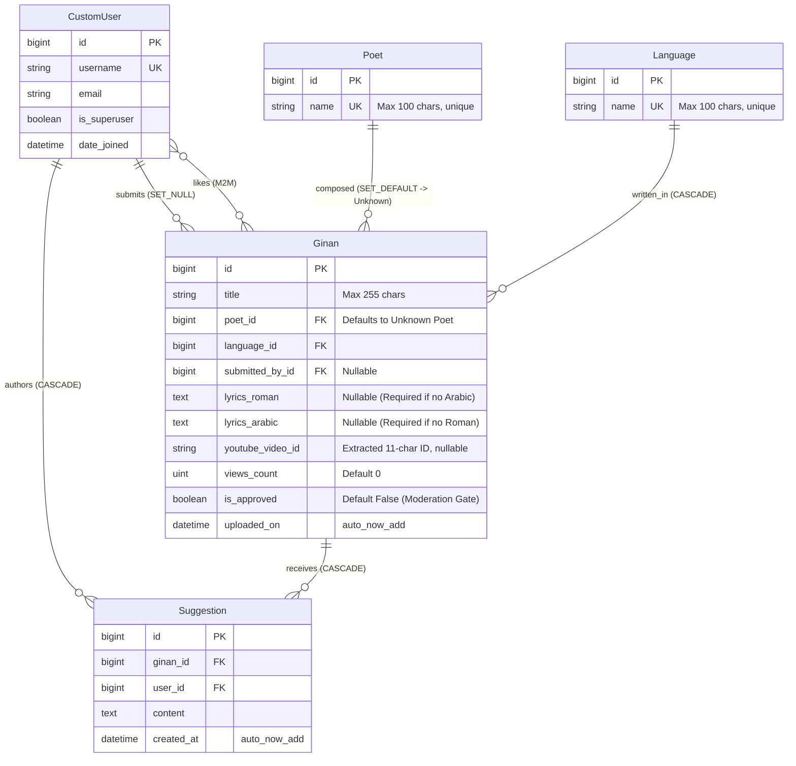

# Qasida — AI-Powered Digital Archive for Ginans & Qasidas

**A full-stack, hypermedia-driven digital archive and multi-page AI OCR & bi-directional transliteration engine for preserving traditional devotional poetry across Roman and Arabic/Persian/Urdu scripts.**

[](https://www.python.org/)
[](https://www.djangoproject.com/)
[](https://htmx.org/)
[](https://tailwindcss.com/)
[](https://cloud.google.com/vision)
[](https://ai.google.dev/)
[](https://neon.tech/)
[](https://render.com/)

---

## Live Deployment & Demo

> **Live Application:** **[Launch Qasida Live Demo](https://your-live-deployment-url.com)** *(Replace with active production URL)*


---

## Problem & Motivation

Traditional **Ginans** and **Qasidas** (devotional poetry composed across Urdu, Persian, Arabic, Gujarati, and Sindhi traditions) have historically lived scattered across aging printed books, fragile community booklets, and handwritten family notebooks. Finding a specific set of verses—or reading them if you only know either the Latin (Roman) alphabet or the nastaliq/Arabic script—has long been a barrier for younger generations, researchers, and global community members.

Digitizing this corpus manually presents three distinct technical hurdles:
1. **Multi-Script Accessibility:** Readers require both **Roman transliteration** and **right-to-left (RTL) Arabic/Persian/Urdu script** side by side, yet physical manuscripts typically exist in only one script.
2. **High-Friction Digitization:** Transcribing multi-page handwritten or printed devotional booklets by hand—and then manually transliterating every stanza into its counterpart script—is tedious and error-prone.
3. **Mobile-First Performance & Discoverability:** Users frequently look up verses on mobile devices in low-connectivity community spaces, requiring SPA-like instant navigation and search without sacrificing server-rendered SEO, OpenGraph metadata, or Schema.org structured data.

**Qasida** solves these problems by combining a **Django + HTMX hypermedia architecture** with a **hybrid Google Cloud Vision + Gemini multimodal AI pipeline** that lets contributors snap up to 10 sequential pages of a physical booklet from their phone camera, automatically extracting the verses and generating synchronized Roman and Arabic/Urdu script versions in seconds.

---

## System Architecture

The diagram below illustrates the actual runtime architecture of the application, detailing the dual-template HTMX rendering layer, the moderated community contribution workflow, and the hybrid Vision/Gemini OCR & transliteration pipeline:

```mermaid
graph TD
    subgraph Client["Browser Client (Mobile & Desktop)"]
        UI["Tailwind CSS Responsive UI<br/>(LTR Roman & RTL Arabic Toggles)"]
        HTMX["HTMX Hypermedia Engine<br/>(hx-get, hx-post, hx-push-url, Debounced Search)"]
        Cam["Multi-Page Camera Scanner<br/>(HTML5 Canvas Resize <=1500px, JPEG 0.82)"]
    end

    subgraph Edge["WSGI & Static Serving (Render)"]
        Gunicorn["Gunicorn WSGI Server"]
        WhiteNoise["WhiteNoise Compressed Static Storage"]
        Middleware["Django Middleware Stack<br/>(Security, CSRF, Auth, HtmxMiddleware)"]
    end

    subgraph Core["Django 4.2 Application (`ginan` & `qasida`)"]
        Router["URL Dispatcher & SEO Engine<br/>(Dynamic Sitemaps, robots.txt, JSON-LD)"]
        Views["Hybrid View Controllers<br/>(Full Page vs. Partial Fragment Switch)"]
        Search["Multi-Keyword Q-Object Search<br/>& Category Filter Engine"]
        Upload["Upload & Moderation Workflow<br/>(Poet De-duplication, YouTube ID Parser)"]
        ScanAPI["AI Lyrics Extraction Endpoint<br/>(`POST /api/scan-lyrics/`)"]
        Pillow["Pillow Image Normalizer<br/>(EXIF Transpose, RGB Convert, <=1600px)"]
    end

    subgraph AI["Hybrid AI OCR & Transliteration Pipeline"]
        Circuit["In-Memory Circuit Breaker<br/>(`_VISION_DISABLED_UNTIL` 300s Cooldown)"]
        Vision["Google Cloud Vision API<br/>(`DOCUMENT_TEXT_DETECTION` + Language Hints)"]
        ScriptDetect["Unicode Script Classifier<br/>(`_is_arabic_script` Ratio > 0.5)"]
        Gemini["Google Gemini Multimodal Failover Cascade<br/>(Flash 3.5 -> 3.6 -> 3.1-Lite -> 3.8)"]
    end

    subgraph Data["Persistence Layer"]
        DB[("PostgreSQL (Neon) / SQLite<br/>CustomUser, Poet, Language, Ginan, Suggestion")]
    end

    UI --> HTMX
    HTMX -->|AJAX / Full Request| Gunicorn
    Cam -->|Base64 JSON Array (Up to 10 Pages)| Gunicorn
    Gunicorn --> WhiteNoise
    WhiteNoise --> Middleware
    Middleware --> Router

    Router --> Views
    Views --> Search
    Views --> Upload
    Router --> ScanAPI

    Search --> DB
    Upload --> DB

    ScanAPI --> Pillow
    Pillow --> Circuit
    Circuit -->|Primary OCR Path| Vision
    Vision -->|Extracted Text| ScriptDetect
    ScriptDetect -->|Counterpart Script Prompt| Gemini
    Circuit -->|Fallback / Direct Multimodal Path| Gemini
    Gemini -->|Structured JSON: Roman + Arabic Lyrics| ScanAPI
```

---

## Key Engineering Highlights

### 1. Hybrid Multi-Page AI OCR & Bi-Directional Transliteration Pipeline (`views.py`)
Rather than relying on a single brittle external API call, the `/api/scan-lyrics/` endpoint implements a resilient, two-stage extraction and transliteration pipeline supporting up to **10 sequential book pages** per scan:
- **Stage 1 (Dual-Stage Image Normalization):** On the client side, selected camera photos are sequentially drawn onto an HTML5 `<canvas>`, scaled to a maximum dimension of `1500px`, and compressed to JPEG (`0.82` quality) to preserve page ordering while minimizing upload bandwidth. On the server side, `_normalize_image_bytes()` uses **Pillow (`ImageOps.exif_transpose`)** to fix mobile camera orientation metadata, normalize color spaces to `RGB`, and clamp dimensions to `1600px` (`LANCZOS` resampling).
- **Stage 2 (Cloud Vision OCR + Circuit Breaker):** The backend first attempts high-accuracy `DOCUMENT_TEXT_DETECTION` via the **Google Cloud Vision API** configured with regional language hints (`['ur', 'ar', 'fa', 'en', 'hi-t-i0-und']`). If Cloud Vision returns an HTTP `403` (e.g., quota/billing restrictions), an in-memory circuit breaker (`_VISION_DISABLED_UNTIL`) trips for **300 seconds**, bypassing the Vision request on subsequent scans to eliminate a 3-second latency penalty.
- **Stage 3 (Unicode Script Heuristic & Multi-Model Gemini Failover):** When Vision succeeds, `_is_arabic_script()` inspects the Unicode codepoint distribution (`\u0600–\u06FF`, `\u0750–\u077F`, `\uFB50–\uFDFF`, `\uFE70–\uFEFF`). If >50% of alphabetic characters belong to Arabic/Persian/Urdu blocks, Gemini is prompted strictly to transliterate into Roman script (and vice versa). If Vision is bypassed, Gemini processes all normalized page images in a single multimodal call—ignoring adjacent page bleed and headers—to output structured JSON containing both scripts. The caller automatically fails over across an ordered model cascade (`gemini-3.5-flash` -> `gemini-3.6-flash` -> `gemini-3.1-flash-lite` -> `gemini-3.8-flash`) with `thinking_budget=0` for low-latency execution.

### 2. Dual-Template HTMX Hypermedia Architecture
Every primary view in `qasida/views.py` inspects `request.htmx` (injected via `django-htmx`'s `HtmxMiddleware`):
- **HTMX Partial Requests (`request.htmx == True`):** Returns lightweight HTML fragments (`partials/home-partial.html`, `partials/ginan-content.html`, `partials/poet-profile-partial.html`, etc.) that swap directly into `#content-area` with `hx-push-url="true"`, updating the browser `<title>` dynamically and firing Google Analytics page-path events without a full page reload.
- **Direct / Crawler Requests (`request.htmx == False`):** Renders the full inheritance hierarchy (`qasida/base.html` -> `qasida/ginan-content-full.html`), ensuring deep links, browser refreshes, and search engine crawlers receive complete HTML documents with canonical URLs, OpenGraph tags, and JSON-LD schema markup.

### 3. Multi-Token `Q` Object Search Reduction & Debounced Live Filtering
The search engine (`views.py:search`) pairs an HTMX input trigger (`hx-trigger="keyup delay:500ms changed"`) with a multi-token relational query builder. Rather than matching the raw query string literally, the backend splits the input into individual search tokens and maps each token into a disjunctive `Q(title__icontains=word) | Q(poet__name__icontains=word) | Q(language__name__icontains=word)` clause. These clauses are combined via `functools.reduce(operator.and_, word_queries)` with `.distinct()`, allowing a user searching `"farsi nasir"` to immediately locate Persian works by Pir Nasir Khusraw in a single SQL query.

### 4. Smart Entity De-Duplication, Validation & Moderation Gatekeeping
Community-contributed archives frequently suffer from duplicate author records and unverified submissions. The upload workflow (`views.py:upload` and `models.py:Ginan`) enforces strict data hygiene:
- **Case-Insensitive Poet De-duplication:** Contributors can attribute a work to `"Unknown"` (resolved via `Poet.objects.get_or_create`), select an existing poet, or enter a new poet name. When a new name is submitted, the backend checks `Poet.objects.filter(name__iexact=new_poet_name).first()` before creating a `.title()`-normalized record, preventing case-variant duplicates.
- **Cross-Field Model Validation:** `Ginan.clean()` overrides Django's model validation lifecycle (invoked via `ginan.full_clean()`) to guarantee that at least one lyric script (`lyrics_roman` or `lyrics_arabic`) is populated before saving.
- **Access-Controlled Moderation State:** Newly uploaded Ginans default to `is_approved=False`. Unapproved records are excluded from public querysets, search results, poet profiles, and XML sitemaps. In `ginanContent`, unapproved entries raise an `Http404` unless the requester is the original `submitted_by` author or a `superuser`. Admins can bulk-approve verified submissions via the custom `make_approved` action in Django Admin.

### 5. Automated SEO & Structured Metadata Engine
To maximize organic discoverability of rare devotional lyrics, the application dynamically generates:
- **Schema.org `CreativeWork` JSON-LD:** Embedded in every full Ginan page (`ginan-content-full.html`), exposing the work's headline, author (`Person`), language (`inLanguage`), and lyric excerpt to search indexers.
- **Priority-Weighted XML Sitemaps (`sitemaps.py`):** Automatically indexes approved Ginans (`priority=0.9`, ordered by `-uploaded_on`), Poets excluding `"Unknown"` (`priority=0.7`), and static views (`priority=0.8`), paired with a dynamic `/robots.txt` endpoint that advertises the absolute sitemap URI while disallowing `/admin/` and `/api/`.

---

## Database & Data Model Overview

The persistence layer is built on **Django ORM**, running against **PostgreSQL (Neon)** in production and **SQLite** in local development.



### Key Schema Design Decisions
- **Safe Deletion Semantics (`SET_DEFAULT` & `SET_NULL`):** Deleting a `Poet` record triggers `on_delete=models.SET_DEFAULT` (calling `get_default_artist()` to reassign works to the `"Unknown"` poet record rather than losing historical lyrics). Similarly, deleting a `CustomUser` preserves their contributed Ginans via `on_delete=models.SET_NULL`.
- **Privacy-Enhanced Media Normalization:** Rather than storing raw, inconsistent YouTube URLs (`youtu.be/...`, `youtube.com/watch?v=...`, `youtube.com/embed/...`), `extract_yt_id()` strips the input down to the canonical 11-character video ID on write, which is then rendered inside a privacy-enhanced `youtube-nocookie.com/embed/` iframe.

---

## Visual Tour & Screenshots

> *See [`ASSETS_CHECKLIST.md`](./ASSETS_CHECKLIST.md) for instructions on capturing and dropping these visuals into `./assets/`.*

| Home Search & Language Filtering | Dual-Script Reader (Roman & RTL Arabic) |
| :---: | :---: |
|  |  |
| *Instant debounced HTMX search across titles, poets, and languages.* | *One-click toggle between Roman transliteration and RTL Arabic/Urdu script + YouTube playback.* |

| Multi-Page AI Lyrics Scanner | Contributor Profile & Moderation Queue |
| :---: | :---: |
|  |  |
| *Queue up to 10 camera/gallery pages for automated OCR and bi-directional transliteration.* | *Contributor upload tracking and admin bulk-approval workflow.* |

---

## Documentation Index

- **[`ARCHITECTURE.md`](./ARCHITECTURE.md):** Deep-dive technical specification covering request lifecycles, state management, image normalization, AI failover logic, and production security hardening.
- **[`ASSETS_CHECKLIST.md`](./ASSETS_CHECKLIST.md):** Exact checklist of screenshots and screen recordings to capture for this showcase.
- **[`SETUP_PUBLIC_REPO.md`](./SETUP_PUBLIC_REPO.md):** Step-by-step Git instructions to publish this `_showcase/` directory as a standalone public repository with zero commit history from the private repo.

---

## Private Repository Notice

> **Note on Source Code Availability:**  
> To protect community moderation workflows, API integrations, and active production configurations, the full source code repository for **Qasida** is maintained privately. This showcase repository provides a comprehensive architectural and engineering overview of the system as built.
>
> **For Recruiters, Engineers & Collaborators:**  
> I am happy to provide a live technical walkthrough of the codebase, discuss the AI OCR/transliteration pipeline in detail, or grant temporary read access to the private repository upon request. Please reach out via **[GitHub (@Kashan-A1i)](https://github.com/Kashan-A1i)**.
